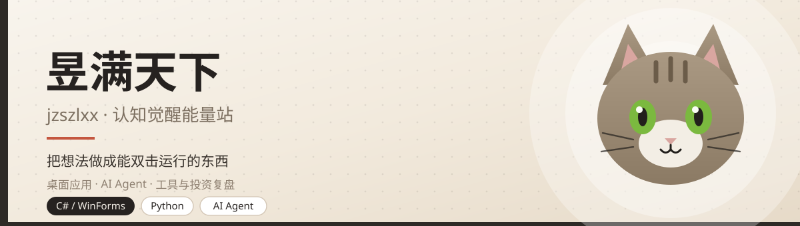
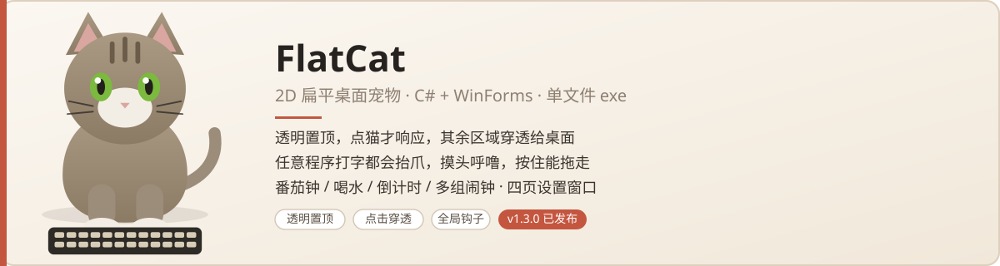

### 你好，我是昱满天下

一个喜欢把想法做成**能双击运行的东西**的人。写桌面应用，也折腾 AI Agent，不太喜欢让东西停在文档和演示里。

现在主要在写 **C# / WinForms** 的桌面程序，用 **Python** 做脚本和数据处理，偶尔碰一点 TypeScript。相信工具要能上手用，才算真的做完。

 

 

### 在做的项目

FlatCat 的几个技术点，做桌面端的朋友可能用得上：

- **透明窗口**用 `UpdateLayeredWindow` + 32bpp 预乘 ARGB，而不是 `TransparencyKey`——后者只能整像素抠色，不支持半透明抗锯齿
- **点击穿透**靠每帧按渲染 alpha 生成命中掩码，光标落在猫身才摘掉 `WS_EX_TRANSPARENT`，其余区域点击直接落到桌面
- **不抢焦点**靠 `WS_EX_NOACTIVATE` + `ShowWithoutActivation`，点猫不会把前台程序切走
- **全局键盘响应**用 `WH_KEYBOARD_LL` 装在专用线程，只读虚拟键码决定抬哪只爪，不记录字符、不落盘、不联网
- **闹钟不重复响**用「年月日时分 + 时间 + 标签」做指纹；星期重复用位掩码 `bit0=周一 … bit6=周日`

 

### 几条我自己信的东西

- 工具要能上手用，才算真的做完
- 先让它跑起来，再让它好看
- 能算清楚的钱和能复现的结论，都别只凭感觉

 

